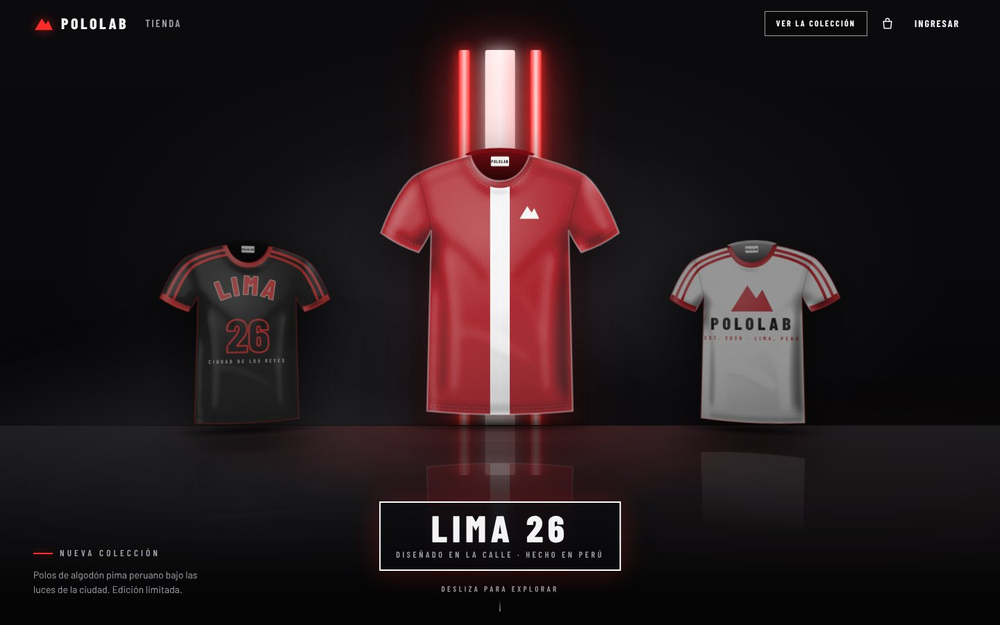
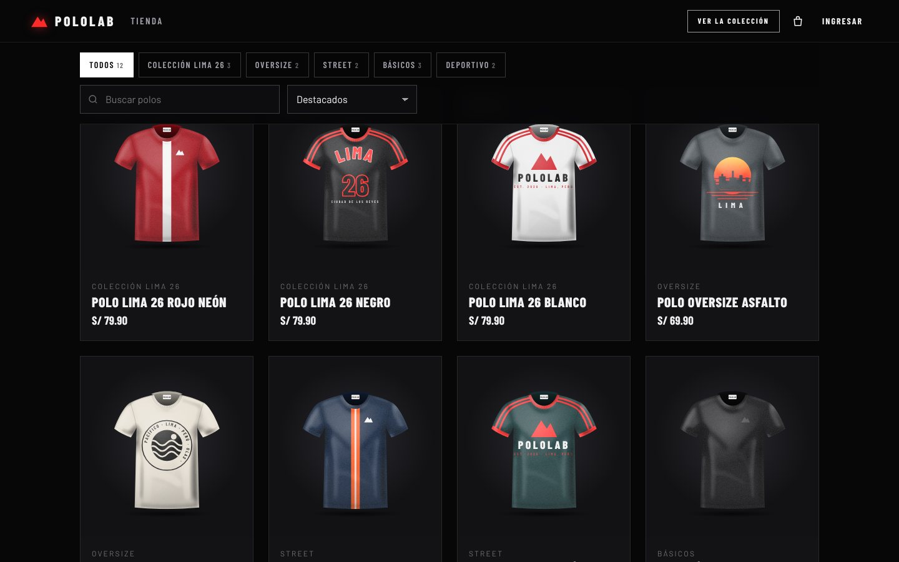
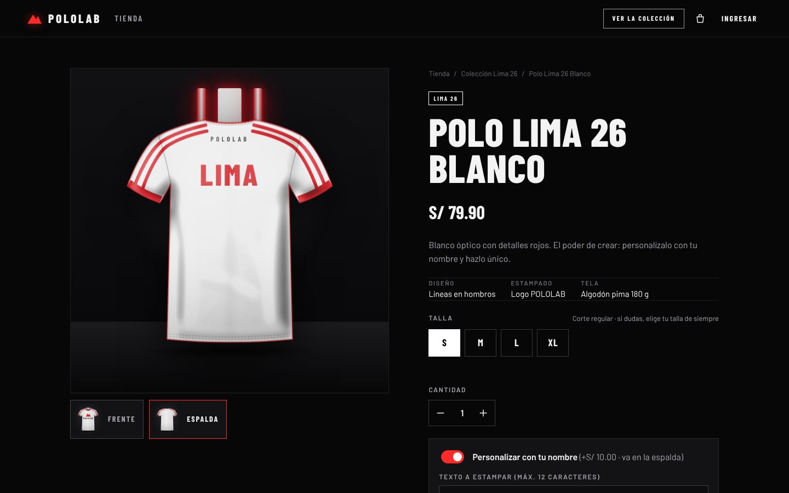
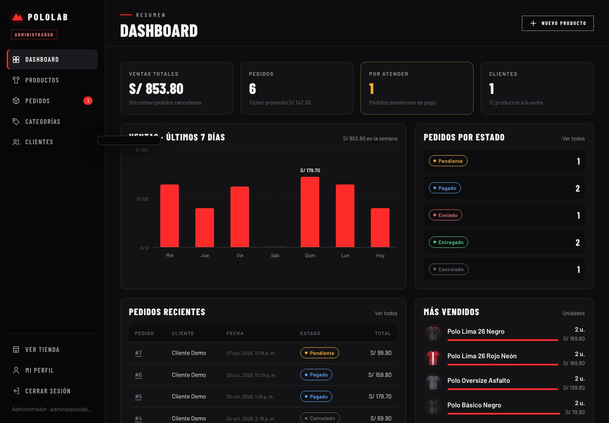

# POLOLAB · Tienda de polos

Tienda online de polos con estética cinematográfica: escenario oscuro, luces de neón, efectos *glitch* al hacer scroll y personalización del polo con tu nombre. Tiene dos sistemas:

- **Cliente:** catálogo, detalle del producto, carrito, compra y seguimiento de pedidos.
- **Administrador:** dashboard de ventas, productos, pedidos, categorías y clientes.



| Tienda | Producto personalizado | Panel de administración |
|---|---|---|
|  |  |  |

## Cómo ejecutarlo

La tienda funciona mientras el servidor esté encendido **en tu computadora**. Si abres `localhost:3000` sin haberlo iniciado, el navegador muestra "localhost rechazó la conexión".

Requisito: **Node.js 22.13 o superior** (versión LTS de <https://nodejs.org>). No hace falta instalar MySQL: usa la base de datos SQLite incluida en Node.

### En Windows (lo más fácil)

1. Instala Node.js desde <https://nodejs.org> (botón LTS, opciones por defecto).
2. Descarga el proyecto: en GitHub elige la rama `claude/busy-davinci-8v96dg`, botón **Code → Download ZIP**, y descomprímelo.
3. Haz doble clic en **`iniciar.bat`**. La primera vez instala las dependencias y luego abre la tienda en el navegador.
4. **No cierres la ventana negra** mientras uses la tienda; si la cierras, la página deja de funcionar.

### Desde la terminal (Windows, Mac o Linux)

```bash
npm install
npm start
```

Abre <http://localhost:3000>. La primera vez se crea la base de datos `data/tienda.db` con productos, categorías y pedidos de ejemplo.

### Cuentas de prueba

| Rol | Correo | Contraseña |
|---|---|---|
| Administrador | `admin@pololab.pe` | `admin123` |
| Cliente | `cliente@pololab.pe` | `cliente123` |

En la página de ingreso hay botones para entrar con cada una. **Cambia la contraseña del administrador** antes de publicar la tienda (Panel → Mi perfil).

## Qué puede hacer cada usuario

### Cliente
- Ver la página de inicio con la colección destacada y los capítulos animados.
- Buscar, filtrar por categoría y ordenar por precio en la tienda.
- Elegir talla (S, M, L, XL) según el stock real, cantidad y **estampar su nombre** en el polo (+S/ 10), con vista previa en vivo.
- Usar el carrito sin registrarse; para pagar debe crear una cuenta o ingresar.
- Confirmar el pedido con datos de envío y método de pago (Yape/Plin, transferencia o contra entrega).
- Ver sus pedidos con el seguimiento (recibido → pagado → en camino → entregado), cancelar los que están pendientes y editar sus datos o contraseña.

### Administrador
- **Dashboard:** ventas totales, pedidos, ticket promedio, pedidos por atender, gráfico de ventas de los últimos 7 días, más vendidos, stock bajo y pedidos recientes.
- **Productos:** crear, editar, ocultar y eliminar. Cada producto tiene precio, categoría, colores, diseño (liso, franja central o líneas en hombros), stock por talla y foto opcional. Si no sube foto, la tienda dibuja el polo con los colores elegidos.
- **Pedidos:** filtrar por estado, buscar por número o cliente, ver el detalle y cambiar el estado. Al cancelar un pedido el stock vuelve al inventario.
- **Categorías:** crear, renombrar y eliminar.
- **Clientes:** ver cuánto ha comprado cada uno y bloquear o reactivar su acceso.

## Reglas de negocio

- Envío S/ 10, **gratis desde S/ 150**. Personalización S/ 10 por polo. Se configuran en `src/util.js`.
- Los precios y el stock siempre se calculan en el servidor; el stock se descuenta dentro de una transacción, así que dos clientes no pueden comprar la última unidad a la vez.
- Los pedidos guardan una copia del nombre, precio y colores del producto: si luego se edita o elimina, el historial no cambia.
- Los pagos **no** están conectados a una pasarela: el pedido queda *pendiente* y el administrador lo marca como *pagado* cuando confirma el Yape o la transferencia.

## Estructura

```
server.js              Arranque del servidor
src/
  app.js               Configuración de Express, sesión y seguridad
  db.js                Tablas SQLite y datos de ejemplo
  auth.js              Contraseñas (scrypt) y sesiones con cookie firmada
  util.js              Validaciones y reglas de negocio
  queries.js           Consultas compartidas
  routes/
    auth.js            Registro, ingreso, perfil
    catalog.js         Productos y categorías públicos
    orders.js          Pedidos del cliente
    admin.js           Todo el panel de administración
public/
  index.html           Inicio (escenario y capítulos)
  tienda.html          Catálogo
  producto.html        Detalle y personalización
  carrito.html         Carrito y compra
  login.html, registro.html, cuenta.html
  admin.html           Panel de administración
  css/                 styles.css (tienda) y admin.css (panel)
  js/                  core.js (compartido) y un archivo por página
test/api.test.js       Pruebas de la API
```

## Personalizar

- **Nombre de la tienda y colección:** `STORE` en `public/js/core.js` (y los textos de `public/index.html`).
- **Colores y tipografías:** variables al inicio de `public/css/styles.css`.
- **Productos de ejemplo:** `DEMO_PRODUCTS` en `src/db.js`. Para empezar de cero borra la carpeta `data/`.

### Variables de entorno (opcionales)

| Variable | Para qué sirve | Por defecto |
|---|---|---|
| `PORT` | Puerto del servidor | `3000` |
| `ADMIN_EMAIL` / `ADMIN_PASSWORD` | Administrador que se crea la primera vez | `admin@pololab.pe` / `admin123` |
| `SEED_DEMO` | Pon `0` para no crear productos ni pedidos de ejemplo | `1` |
| `SESSION_SECRET` | Clave para firmar las sesiones (si no se define, se genera en `data/secret.key`) | generada |
| `STORE_UTC_OFFSET` | Zona horaria para agrupar las ventas por día | `-5` (Perú) |

## Pruebas

```bash
npm test
```

Cubren registro e ingreso, compra con descuento de stock, compras sin stock suficiente, cancelaciones que devuelven el stock, permisos del administrador, subida de imágenes y bloqueo de clientes.
